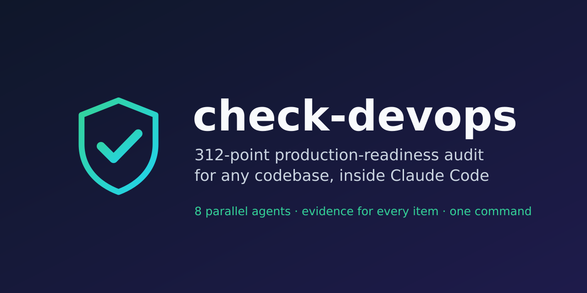
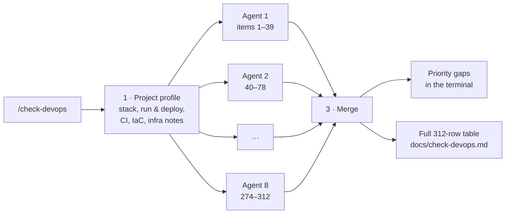

<p align="center">
  
</p>

<p align="center">
  <a href="LICENSE"></a>
  
  
  
  <a href="#contributing"></a>
</p>

<h3 align="center">Your app works. But is it <i>production-ready</i>?</h3>

<p align="center">
  One command. 8 parallel agents. 312 checks across security, databases, DevOps, observability,<br>
  distributed systems, payments, compliance and AI. Every verdict comes with evidence: a <code>file:line</code> or a command output.
</p>

---

## Why

AI makes it easy to ship an app in a weekend, and just as easy to ship it without rate limiting, backups you have ever restored,
CSRF protection, graceful shutdown, or a single alert. Nobody forgets these on purpose. There are simply too many of them to
keep in your head.

**check-devops** turns that list into an audit. It reads your repository the way a senior backend/SRE reviewer would, item by
item, and tells you what is there, what is weak, what is missing, and what does not apply to your project, with proof.

- 🔎 **Evidence or nothing.** No ✅ without a `file:line` or a command result. If it can't find something it says *unverified*, not *missing*.
- 🛡️ **Read-only.** It never edits your code. You get a report and choose what to fix.
- ⚡ **Fast and parallel.** 8 Explore subagents scan ~39 items each at the same time.
- 🧭 **Prioritized.** Security and data-loss gaps first, each with the *smallest* fix that closes it.
- 🏗️ **Infra-aware.** Items covered outside the repo (reverse proxy, firewall, backups, uptime monitors) count when your notes say so.
- 🔁 **Re-runnable.** The full table lands in `docs/check-devops.md`; each new run diffs against the last one, so you can watch the score move.
- 🌍 **Any stack.** Node, Python, Go, Rust, Java, Ruby, PHP, .NET, mobile, monorepos. The report is written in your language.

## Quick start

### Option 1: install as a Claude Code plugin (recommended)

Inside Claude Code:

```text
/plugin marketplace add MagnusMagi/check-devops
/plugin install check-devops@check-devops
```

### Option 2: install as a plain skill

```bash
git clone https://github.com/MagnusMagi/check-devops.git
cp -r check-devops/skills/check-devops ~/.claude/skills/
```

For a single project only, copy it into `<project>/.claude/skills/` instead.

### Run it

Open Claude Code in your project and type:

```text
/check-devops
```

or just ask: *"run check-devops on this repo"*. (Installed as a plugin, the command is `/check-devops:check-devops`.)

## How it works



1. **Profile.** Claude reads what defines the project: `CLAUDE.md`, `package.json` / `pyproject.toml` / `go.mod` / `Cargo.toml`,
   `Dockerfile`, compose files, CI workflows, IaC. If a machine-level note exists (for example `~/CLAUDE.md`), server-side
   items such as the reverse proxy, firewall and backups are counted as *covered by infrastructure*.
2. **Parallel scan.** Eight Explore subagents (Sonnet, to keep it cheap) each take a slice of the checklist and return one line
   per item: `No | Status | Evidence | Note`.
3. **Merge and report.** You get a summary and a prioritized gap list in the terminal; the full table is written to disk.

If the repo has a [graphify](https://github.com/Graphify-Labs/graphify) knowledge graph (`graphify-out/graph.json`), agents query the graph first and only open the lines it points to, which makes large repos much cheaper to scan.

### Status legend

| Status | Meaning |
|:-:|---|
| ✅ | Present and correct, with evidence |
| ⚠️ | Partial, weak, or could not be verified |
| ❌ | Missing, and this project needs it |
| ➖ | Not applicable to this project (with a 3–5 word reason) or purely conceptual |

## Example output

*Illustrative, from a typical Node.js + Postgres SaaS:*

```text
check-devops — 2026-11-12

✅ 141   ⚠️ 58   ❌ 23   ➖ 90
Solid foundations, but no rate limiting on auth, untested backups and no alerting.

Priority gaps
1. ❌ #2 Rate Limiting / #102 Brute Force Protection
   Why: /api/auth/login accepts unlimited attempts; credential stuffing is trivial.
   Fix: add a per-IP + per-account limiter on the auth routes (e.g. 5/min).
   Evidence: src/routes/auth.ts:14 (no middleware), no limiter in package.json
2. ❌ #154 Testing Backup Restores
   Why: nightly pg_dump exists, but nobody has ever restored one.
   Fix: monthly restore into a scratch DB + row-count check, in CI.
   Evidence: scripts/backup.sh:1, no restore script or job
3. ⚠️ #59 Graceful Shutdown
   Why: SIGTERM kills in-flight requests on every deploy.
   Fix: server.close() + drain the DB pool on SIGTERM.
   Evidence: src/server.ts:88
…

Full table: docs/check-devops.md (vs last run: +6 ✅, −4 ❌)
Which of these do you want to fix first?
```

## What it checks

312 items in 13 areas. The full list is in [`skills/check-devops/checklist.md`](skills/check-devops/checklist.md).

| # | Area | Examples |
|---|---|---|
| 1–39 | **Core backend & security** | rate limiting, secrets, authN/authZ, input validation, CORS, migrations, backups, timeouts, retries, idempotency, circuit breakers, TLS, SQLi, XSS |
| 40–92 | **Reliability, delivery & quality** | CSRF, transactions, race conditions, N+1, webhooks, health checks, graceful shutdown, alerting, tracing, feature flags, rollbacks, IaC, load testing, GDPR |
| 93–132 | **Security deep dive** | CSP, security headers, SSRF, path traversal, command injection, IDOR, mass assignment, passkeys, RBAC, RLS, cookie flags, secret rotation, audit logs, supply chain, lockfiles |
| 133–157 | **Databases** | keys & constraints, EXPLAIN, locks, deadlocks, isolation levels, full-text search, cursor pagination, point-in-time recovery, restore tests, zero-downtime migrations |
| 158–175 | **Storage, delivery & cloud** | Redis, object storage, presigned URLs, compression, HTTP caching, edge, serverless, cold starts, Kubernetes, autoscaling, regions, vendor lock-in |
| 176–194 | **SRE & observability** | SLOs, incident response, postmortems, runbooks, status pages, metrics, log levels, correlation IDs, PII in logs, canary & rolling deploys, environment parity |
| 195–214 | **Git, code quality & testing** | PRs, commit messages, releases, changelogs, linting, typing, pre-commit hooks, coverage, flaky tests, smoke tests, SAST/DAST |
| 215–241 | **APIs & distributed systems** | REST, GraphQL, WebSockets, SSE, OpenAPI, backward compatibility, deprecation, third-party limits, pub/sub, DLQs, at-least-once delivery, distributed locks, backpressure |
| 242–251 | **Data correctness & runtime** | timestamps, ISO 8601, floating point, money handling, i18n/l10n, event loop, non-blocking I/O, streaming, batching |
| 252–266 | **Frontend** | bundle size, code splitting, SSR/SSG, Core Web Vitals, SEO, Open Graph, optimistic UI, loading/empty states, form UX |
| 267–289 | **Product & business** | email deliverability (SPF/DKIM/DMARC), payments & webhooks, billing, refunds, PCI, VAT, analytics, cookie consent, data export/deletion, multi-tenancy, abuse, forced app updates |
| 290–299 | **AI / LLM apps** | prompt injection, LLM costs, token limits, embeddings, vector DBs, RAG, streaming, evals, reviewing AI code, hallucinated dependencies |
| 300–312 | **Engineering craft** | refactoring, comments, DRY vs premature abstraction, YAGNI, READMEs, ADRs, domains, certificate renewal, package managers |

Items that don't fit your project (no payments, no frontend, no LLM) are marked ➖, so a CLI tool is not punished for lacking Core Web Vitals.

## Customize

Everything is two Markdown files, so fork and edit freely:

- **Your own checklist.** Edit [`checklist.md`](skills/check-devops/checklist.md): add company rules, remove areas you never need. Keep the numbering and update the agent ranges in `SKILL.md`.
- **Cheaper or deeper.** Change `model: "sonnet"` in `SKILL.md` to `"haiku"` for speed or to your main model for depth, or change the number of agents.
- **Report location.** The table goes to `docs/check-devops.md`; change it in the *Report format* section.

## FAQ

**Will it change my code?**
No. It is report-only. At the end it asks which items you want to fix, and nothing happens until you answer.

**How much does a run cost?**
One short profiling step on your main model plus 8 Sonnet subagents. It depends on repo size; a graphify graph cuts it down a lot on large codebases.

**Does it replace a security audit or pen test?**
No. It is a broad, evidence-based readiness review that tells you where to look. It catches the boring, common gaps; it does not replace a specialist hunting the subtle ones.

**Monorepos?**
Run it from the package or service root you want audited, or from the repo root for a whole-system view.

**Can I use the checklist without Claude Code?**
Yes. `checklist.md` is a plain numbered list. Use it for code reviews, launch checklists or onboarding.

## Contributing

Issues and PRs are welcome, especially:

- checklist items that are missing, duplicated, or should be split,
- reports of false ✅ / ❌ on a specific stack (please include the evidence line),
- better agent prompts for specific ecosystems.

Before opening a PR, run `claude plugin validate .` in the repo root.

## License

[MIT](LICENSE). If check-devops caught something before your users did, a ⭐ helps others find it.
